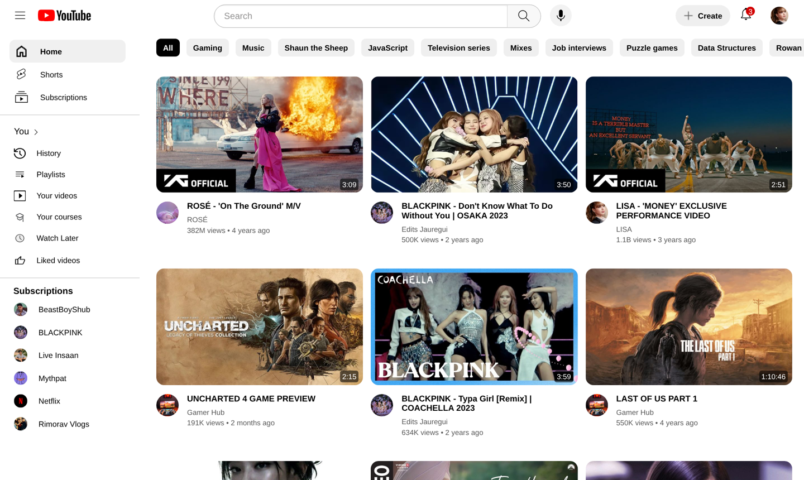
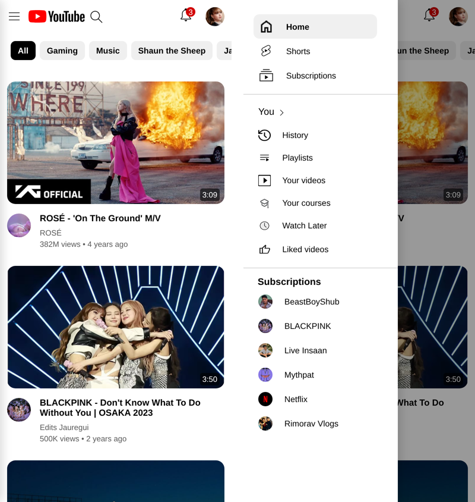

# 📺 YouTube Clone

A front-end clone of YouTube's homepage, built from scratch with HTML and CSS (plus a few lines of JavaScript for the menu) — replicating the core UI of one of the world's most visited websites, on desktop and mobile.

🔗 **Live Demo:** [techasmita.github.io/Youtube-Clone-Website](https://techasmita.github.io/Youtube-Clone-Website/)

---

## ✨ Features

- **YouTube-style Header** — hamburger menu, logo, search bar with voice search icon, Create button, notification bell with badge, and user avatar
- **Sidebar Navigation** — Home, Shorts, Subscriptions, History, Playlists, Your Videos, Watch Later, Liked Videos
- **Subscriptions Panel** — Displays subscribed channel thumbnails (BeastBoyShub, BLACKPINK, Mythpat, Netflix, and more)
- **Filter Chips** — Category pills for All, Gaming, Music, JavaScript, Data Structures, Rowan Atkinson, and more
- **Video Grid** — Thumbnail cards with video duration, channel avatar, title, view count, and upload date
- **Clickable Thumbnails** — Each card links to the actual YouTube video
- **Responsive Layout** — 3–4 videos per row on desktop, 2 on tablets, 1 on phones; on small screens the sidebar becomes a slide-out drawer and the header collapses to a search icon, like the YouTube mobile site
- **Working Hamburger Menu** — hides the sidebar on desktop, opens it as a drawer on phones and tablets

---

## 🛠️ Tech Stack

| Technology | Usage |
|---|---|
| HTML5 | Page structure and semantic layout |
| CSS3 | Styling, grid layout, flexbox, hover effects, media queries |
| JavaScript | Hamburger menu / sidebar drawer toggle |

---

## 📁 Project Structure

```
Youtube-Clone-Website/
├── index.html              # The YouTube homepage clone
├── styles/
│   ├── general.css         # Base font and page spacing
│   ├── header.css          # Top bar: logo, search, Create, notifications
│   ├── sidebar.css         # Left navigation and subscriptions
│   ├── categorybuttons.css # Filter chips
│   ├── video.css           # Video grid and cards
│   └── responsive.css      # Tablet/phone layout + sidebar drawer
├── thumbnails/             # Video thumbnails and icons
├── profilepics/            # Channel profile pictures
├── favicon-files/          # Favicon set
├── screenshots/            # README previews
├── grid.html, flexbox.html, position.html   # CSS layout practice pages
├── readme.txt              # My HTML/CSS learning notes
└── README.md
```

---

## 🚀 Getting Started

```bash
# Clone the repository
git clone https://github.com/techAsmita/Youtube-Clone-Website.git
cd Youtube-Clone-Website

# Open in your browser
open index.html          # macOS
start index.html         # Windows
xdg-open index.html      # Linux
```

No dependencies. No build step. Just open `index.html` in any browser.

---

## 📸 Preview

> A faithful recreation of YouTube's homepage UI — sidebar, video feed, filter chips, and all.

**Desktop**



**Mobile** — feed and slide-out sidebar



---

## 🙋‍♀️ About

Built by **Asmita** — Computer Engineering student at Thapar Institute of Engineering & Technology (TIET), passionate about building real-world UI projects and AI/ML systems.

- 🔗 GitHub: [@techAsmita](https://github.com/techAsmita)

---

## 📄 License

This project is for educational purposes only. YouTube and all related assets are trademarks of Google LLC.
